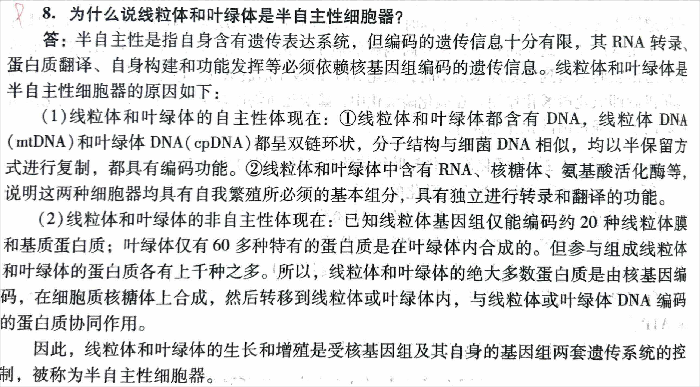
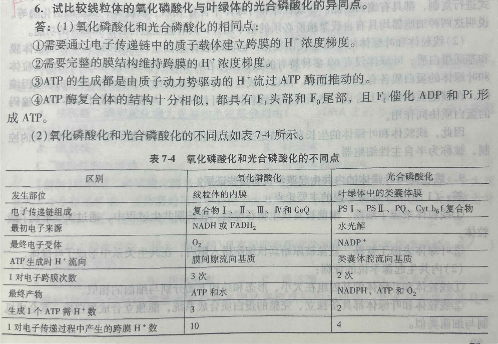

### Front
线粒体的超微结构（区室化分布）及各自功能

### Back
线粒体由内外两层单位膜包被，其区室化分布自外向内分为四个主要部分：**外膜**、**膜间隙**、**内膜**和**线粒体基质**。

1. **外膜（Outer Membrane）**
   - **结构与组成特征**：厚约 \(6\text{ nm}\)，为平滑的单位膜。蛋白质与脂质质量比约为 1:1。含有由孔蛋白构成的桶状通道，允许相对分子质量小于 \(5000\text{ Da}\) 的分子自由通过。标志酶为**单胺氧化酶**。
   - **功能**：起界膜作用；参与膜磷脂合成、肾上腺素氧化、色氨酸降解与脂肪酸链延长，对外来物质进行初步分解；识别并转运细胞质中合成的线粒体蛋白质。

2. **膜间隙（Intermembrane Space）**
   - **结构与组成特征**：位于内外膜之间的空间，宽度通常维持在 \(6\text{--}8\text{ nm}\)，其液态介质环境与胞质溶胶相似。标志酶为**腺苷酸激酶**。
   - **功能**：积累由呼吸链泵出的质子（\(H^+\)），用于建立并维持跨内膜的质子电化学梯度；储存细胞色素 c（\(Cyt\ c\)）、凋亡诱导因子（\(AIF\)）等死亡促进因子，在凋亡信号刺激下释放至细胞质以启动细胞凋亡。

3. **内膜（Inner Membrane）**
   - **结构与组成特征**：厚约 \(6\text{--}8\text{ nm}\)，向内折叠形成**嵴（Cristae）**以大幅增加膜表面积。蛋白质/脂质质量比极高（约 3:1），缺乏胆固醇，富含心磷脂，对大多数离子和小分子高度不通透。标志酶为**细胞色素氧化酶**。
   - **功能**：分布有呼吸链电子传递体（复合物 I–IV）和 \(F_0F_1\text{-ATP}\) 合酶，是进行电子传递和氧化磷酸化合成 \(ATP\) 的主要场所；借助膜电位驱动 \(Ca^{2+}\) 等离子的跨膜转运；调控线粒体通透性转变孔（\(mtPTP\)）的开放以介导细胞凋亡。

4. **线粒体基质（Mitochondrial Matrix）**
   - **结构与组成特征**：内膜所包围的充满可溶性蛋白质的胶状物质，具有特定的 pH 和渗透压。含有致密颗粒（与储积 \(Ca^{2+}\) 有关）、环状 \(mtDNA\)、\(RNA\)、核糖体及转录翻译因子。标志酶为**苹果酸脱氢酶**（或三羧酸循环相关酶类）。
   - **功能**：含有催化三羧酸循环（TCA 循环）、脂肪酸 \(\beta\)-氧化、丙酮酸氧化及氨基酸降解的酶系，是代谢物彻底氧化分解的场所；利用自身的遗传体系进行遗传信息的转录与部分蛋白质的翻译。

---

### Front
线粒体的融合与分裂机制及其生物学意义

### Back
线粒体的分裂与融合现象是线粒体形态调控的基本方式，也是线粒体数目调控的基础。

**一、 分子与细胞生物学机制**
1. **分子生物学基础**：
   - **线粒体融合**：依赖于特定的基因和蛋白质（类似于 GTPase，在哺乳动物中被称为线粒体融合素）的调控。
   - **线粒体分裂**：依赖于特定的基因和蛋白质调控，其中必需的一类发动蛋白（dynamin）同样是一类大分子 GTPase。
   - 介导线粒体融合及分裂的基因均属于发动蛋白相关蛋白基因超家族的成员。
2. **结构动力学基础**：
   - 线粒体分裂装置的主体是**线粒体分裂环**。
   - 线粒体分裂过程分为三个阶段：
     - **早期**：线粒体分裂的准备阶段，膜内陷尚未发生；
     - **中期**：线粒体膜呈现环形内陷并逐渐加深；
     - **后期**：线粒体膜被断裂，线粒体一分为二。

**二、 生物学意义**
1. **平衡氧化损伤以保障功能**：线粒体基质中含有高水平的氧化自由基，容易导致 DNA 损伤。线粒体通过不断的融合与分裂来平衡这种损伤，以保证部分遗传物质受损的线粒体可以正常工作。
2. **调控线粒体形态与分布**：线粒体的融合与分裂是线粒体大小、数目及分布调控的基础。
3. **实现遗传信息的共享**：植物细胞中线粒体的遗传信息在线粒体之间呈现出显著的不平等分布，需要依赖频繁的线粒体融合与分裂来实现遗传信息的共享。

---

### Front
论述：ATP合酶的结构与结合变构机制

### Back
**一、 ATP合酶的结构**

ATP合酶（又称 \(F_1F_0\text{-ATP}\) 合酶）由亲水性的 **\(F_1\) 头部** 和疏水性的 **\(F_0\) 基部** 两部分组成，二者通过“转子”和“定子”形成双重结合：

1. **\(F_1\) 头部（亲水性头部）**：
   - 伸在膜外（线粒体基质侧或叶绿体基质侧）的水溶性部分。
   - 由 5 种类型的 9 个亚基组成，组分为 **\(\alpha_3\beta_3\gamma\delta\varepsilon\)**。
   - **\(\alpha_3\beta_3\)**：\(\alpha\) 和 \(\beta\) 亚基交替排列形成“橘瓣”状六聚体结构，\(\beta\) 亚基具有催化 \(ATP\) 合成或水解的活性位点。
   - **\(\gamma\varepsilon\)**：\(\gamma\) 与 \(\varepsilon\) 亚基结合形成“转子”轴，深入到 \(\alpha_3\beta_3\) 的中央，调节 3 个 \(\beta\) 亚基催化位点的开放与关闭。
   - **\(\delta\)**：为 \(F_1\) 和 \(F_0\) 相连接所必需。

2. **\(F_0\) 基部（疏水性基部）**：
   - 嵌于线粒体内膜（或类囊体膜）中，为疏水性蛋白质复合体。
   - 由 **\(a\)、\(b_2\)、\(c_{8\text{--}15}\)** 种亚基组成。其中 \(c\) 亚基形成环状结构（\(c\)-环），与 \(\gamma\) 亚基相连组成“转子”，参与跨膜质子通道的形成；\(a\) 和 \(b\) 亚基参与跨膜质子通道构成。

3. **定子（Stator）与转子（Rotor）**：
   - **转子**：由 \(c\)-环与 \(\gamma\varepsilon\) 轴结合组成。当质子通过 \(F_0\) 质子通道时驱动 \(c\)-环旋转，带动 \(\gamma\) 轴在 \(\alpha_3\beta_3\) 中央旋转。
   - **定子**：由 \(a\)、\(b\)、\(\delta\)（以及 OSCP 等）亚基共同组成，在侧翼将 \(\alpha_3\beta_3\) 头部固定于 \(F_0\)，使 \(\alpha_3\beta_3\) 保持固定位置，防止其随转子旋转。

**二、 结合变构机制（旋转催化模型）**

结合变构假说（Boyer 的结合变构模型）阐明了质子跨膜电化学梯度驱动 \(ATP\) 合成的催化机理：

1. **质子梯度的作用**：质子梯度的能量并不是直接用于形成 \(ATP\) 分子中的高能磷酸键，而是用于驱动转子旋转，使合成好的 \(ATP\) 从酶分子催化位点上解脱下来。
2. **\(\beta\) 亚基的三种不同构象**：
   - 虽然 3 个 \(\beta\) 催化亚基的氨基酸序列完全相同，但在任一时刻，其构象与对核苷酸的亲和力互不相同：
     - **\(O\) 态（Open/开放构象）**：对核苷酸亲和力极低，结合的 \(ATP\) 从酶表面释放，空出的位点可重新结合新的 \(ADP\) 和 \(P_i\)。
     - **\(L\) 态（Loose/松散结合构象）**：即疏松构象，\(ADP\) 和 \(P_i\) 可松散结合于其上，但不能催化合成 \(ATP\)。
     - **\(T\) 态（Tight/紧密结合构象）**：即紧密构象，\(ADP\) 和 \(P_i\) 被紧密结合并促使二者反应形成 \(ATP\)。
3. **旋转催化过程**：
   - 跨膜质子流穿过 \(F_0\) 通道，驱动 \(c\)-环及与其连接的 \(\gamma\) 亚基旋转。
   - \(\gamma\) 亚基顶端高度不对称，其相对于 \(\alpha_3\beta_3\) 头部每旋转 \(120^\circ\)，就会依次改变 3 个 \(\beta\) 亚基的构象，使其按照 **\(L \rightarrow T \rightarrow O \rightarrow L \dots\)** 的顺序发生循环转变。
   - \(\gamma\) 亚基每完整旋转一周（\(360^\circ\)），每一个 \(\beta\) 亚基都经历一次完整的构象转变循环，共同催化合成并释放 3 个 \(ATP\) 分子。

---

<!-- anki-id: cell-biology-jsonl-000117 -->
### Front
氧化呼吸链电子传递的过程？

### Back
**一、 电子传递链的组成与排列顺序**
线粒体内膜上的电子载体按氧化还原电位从低到高的顺序排列，主要包含四个跨膜蛋白复合体以及泛醌（\(\text{CoQ}\)）和细胞色素 c（\(\text{Cyt c}\)）两个可动电子载体。电子传递途径主要分为 \(\text{NADH}\) 呼吸链（主呼吸链）和 \(\text{FADH}_2\) 呼吸链。

**二、 电子传递与质子泵出的具体步骤（以 \(\text{NADH}\) 主呼吸链为例）**
1. **复合体Ⅰ（\(\text{NADH}\) 脱氢酶 / \(\text{NADH-CoQ}\) 还原酶）**：
   - \(\text{NADH}\) 被氧化，释放 2 个电子和 2 个 \(\text{H}^+\) 被黄素单核苷酸（\(\text{FMN}\)）接受并还原为 \(\text{FMNH}_2\)，\(\text{NADH}\) 氧化为 \(\text{NAD}^+\) 重新进入三羧酸循环。
   - \(\text{FMNH}_2\) 将一对电子经铁硫蛋白（\(\text{Fe-S}\)）传递给泛醌（\(\text{CoQ}\)）。
   - 伴随一对电子传递，复合体Ⅰ将 4 个 \(\text{H}^+\) 从基质泵入膜间隙。

2. **复合体Ⅱ（琥珀酸脱氢酶 / 琥珀酸-\(\text{CoQ}\) 还原酶）**（适用于 \(\text{FADH}_2\) 途径）：
   - 催化琥珀酸脱氢生成延胡索酸，电子经 \(\text{FAD}\) 辅基和 \(\text{Fe-S}\) 中心传递给泛醌（\(\text{CoQ}\)）。
   - 复合体Ⅱ仅传递电子，无 \(\text{H}^+\) 跨膜泵出。

3. **泛醌（CoQ）与 Q 循环**：
   - 泛醌接受电子并从基质中结合 2 个 \(\text{H}^+\) 还原为全醌（\(\text{QH}_2\)）。
   - \(\text{QH}_2\) 在内膜中通过 Q 循环传递电子：两个 \(\text{QH}_2\) 依次氧化，共将 4 个 \(\text{H}^+\) 泵入膜间隙；同时 2 个电子经 \(\text{2Fe-2S}\) 和细胞色素 \(\text{c}_1\) 传递给细胞色素 c，另 2 个电子经 \(\text{Cyt b}_L\) 和 \(\text{Cyt b}_H\) 参与循环再生成一个 \(\text{QH}_2\)。

4. **复合体Ⅲ（\(\text{CoQ-Cyt c}\) 还原酶 / 细胞色素 \(\text{bc}_1\) 复合物）**：
   - 催化电子从还原泛醌（\(\text{QH}_2\)）传递给水溶性电子载体细胞色素 c。
   - 每传递一对电子，复合体Ⅲ向膜间隙转移 4 个 \(\text{H}^+\)。

5. **复合体Ⅳ（细胞色素 c 氧化酶）**：
   - 细胞色素 c 将电子传递给复合体Ⅳ，电子依次沿 \(\text{Cu}_A \to \text{Cyt a} \to \text{Cyt a}_3\text{-Cu}_B\) 传递，最终传递给分子氧 \(\text{O}_2\)。
   - 消耗基质中 2 个 \(\text{H}^+\) 将 \(\frac{1}{2}\text{O}_2\) 还原为 \(\text{H}_2\text{O}\)，同时从基质向膜间隙泵出 2 个 \(\text{H}^+\)。

**三、 质子跨膜梯度的形成**
一对电子沿 \(\text{NADH}\) 主呼吸链传递至 \(\text{O}_2\) 的过程中，复合体Ⅰ泵出 4 个 \(\text{H}^+\)、复合体Ⅲ泵出 4 个 \(\text{H}^+\)、复合体Ⅳ泵出 2 个 \(\text{H}^+\)，共将 10 个 \(\text{H}^+\) 质子由线粒体基质泵入膜间隙。这形成了跨线粒体内膜的质子电化学梯度，驱动 \(\text{ATP}\) 合成。

---

### Front
简述线粒体与常见的疾病

### Back
1. **线粒体病定义**：由线粒体功能障碍引起的疾病统称为线粒体病。
2. **常见疾病类型**：包括克山病（心肌线粒体病）、脑坏死、心肌病、肿瘤、不育及帕金森综合征等。
3. **致病原因与发生机制**：
   - **基因突变**：来源于线粒体DNA（mtDNA）的异常（突变、缺失、重排）或核DNA突变，导致呼吸链电子传递酶系和氧化磷酸化酶系发生异常。
   - **营养缺乏（缺硒）**：硒对线粒体膜具有稳定作用，缺硒会导致心肌细胞线粒体膨胀、嵴稀少且不完整，使ATP合成酶等活性明显下降。
   - **酶缺陷与氧化损伤**：催化不同环节的酶缺失或缺陷；或因线粒体中氧自由基生成过多、抗氧化酶（如SOD）活性下降，破坏线粒体结构与功能，导致细胞衰老与死亡。

---

### Front
简述叶绿体的分化、去分化与分裂

### Back
1. **叶绿体的分化**：
   - **发生时期**：主要发生在幼叶的形成和生长阶段。
   - **主要表现**：在形态上表现为体积的增大、内膜系统的形成以及叶绿素的积累；在生化和分子生物学上，体现为叶绿体功能所需酶、蛋白质和大分子的合成、运输及定位。
2. **叶绿体的去分化**：
   - 叶绿体的分化在特定情况下是可逆的。例如，当叶肉细胞经组织培养形成愈伤组织细胞时，叶绿体会发生去分化并再次形成原质体。
3. **叶绿体的分裂**：
   - **增殖方式**：质体和叶绿体通过分裂进行增殖，生长的幼叶中常发生叶绿体的分裂。
   - **分裂装置**：由与叶绿体分裂所有相关蛋白质组成的成分功能单位构成，包括分裂环以及分裂环以外的相关蛋白质。

---

### Front
简述叶绿体的结构特点与作用

### Back
**一、结构特点**
叶绿体超微结构由**叶绿体膜**、**类囊体**和**叶绿体基质**三个部分组成：
1. **叶绿体膜**：由外膜和内膜构成的双层膜结构，内外膜之间为膜间隙。
   - **外膜**：通透性大，含有孔蛋白。
   - **内膜**：通透性差，对物质透过具有较强选择性，是细胞质和叶绿体之间的功能屏障，分布有选择性转运蛋白。
2. **类囊体**：由内膜衍生而来的封闭扁平膜囊结构，内部空间称为类囊体腔。
   - **结构分布**：包括多层有序叠置成垛的**基粒类囊体**以及贯穿于基粒之间的**基质类囊体**（基质片层）。
   - **膜成分与功能**：类囊体膜上镶嵌有光合色素（叶绿素、类胡萝卜素）和蛋白质复合物（光系统 PSⅠ、PSⅡ、Cyt \(b_6f\) 复合物及 \(\text{CF}_0\text{-CF}_1\text{ ATP}\) 合酶），是进行光反应和光合磷酸化的场所。
3. **叶绿体基质**：
   - 主要成分为可溶性蛋白质及代谢活跃物质，其中含量最高的是**核酮糖-1,5-二磷酸羧化酶/加氧酶（RuBP羧化酶/加氧酶）**。
   - 含有参与 \(\text{CO}_2\) 固定（暗反应/碳同化）的所有酶类，同时含有叶绿体 DNA（cpDNA）、RNA、核糖体、脂滴和淀粉粒等。

**二、主要作用**
1. **进行光合作用与能量转换**：
   - **光反应**（类囊体膜）：吸收光能并转化为电能，生成 \(\text{ATP}\) 和 \(\text{NADPH}\)，同时水光解放出 \(\text{O}_2\)。
   - **碳同化/暗反应**（叶绿体基质）：利用光反应产生的 \(\text{ATP}\) 和 \(\text{NADPH}\) 的驱动力，将 \(\text{CO}_2\) 还原固定为糖类等有机物，将活跃化学能转化为稳定的化学能。
2. **脂质合成**：叶绿体也是细胞内进行脂质合成的重要部位。
3. **半自主性遗传与表达**：作为半自主性细胞器，依靠自身基因组（cpDNA）和核糖体独立合成部分自身蛋白。

---
### Front
简述光合色素的分类，并注明天线色素与反应中心色素

### Back
光合色素主要包括**叶绿素**、**类胡萝卜素**和**藻胆素**三类，按功能可划分为**天线色素（捕光色素）**与**反应中心色素**：

1. **叶绿素**（光合作用的主要色素）：
   - **反应中心色素**：在大约 300 个叶绿素分子组成的光合单位中，只有**一对特殊的叶绿素 a 分子**属于反应中心色素，具有将光能转化为化学能（引发氧化还原反应）的功能。
   - **天线色素（捕光色素）**：其余绝大部分叶绿素分子均属于天线色素，主要负责吸收光能并传递给反应中心。

2. **类胡萝卜素**（类囊体膜上的辅助色素）：
   - **色素类型与归类**：包括 \(\beta\)-胡萝卜素和叶黄素等，均属于**天线色素**。
   - **作用**：吸收叶绿素不能吸收的光，提高光吸收效率；同时能从激发的叶绿素分子上回收多余的能量并以热能形式释放。

3. **藻胆素**（辅助色素）：
   - **色素类型与归类**：仅存在于一些细菌和藻类中，属于**天线色素**。
   - **作用**：能够吸收叶绿素不能吸收的光并转移给叶绿素，进入反应途径。

---

### Front
论述光合碳同化的三条途径（卡尔文循环/C3途径、C4途径、CAM途径）的简要过程与特点

### Back
光合碳同化包含卡尔文循环（C3途径）、C4途径和景天酸代谢途径（CAM途径）。其中卡尔文循环是光合碳代谢最基本、最普遍的途径，也是唯一具备合成淀粉等产物能力的途径；C4途径和CAM途径是对C3途径的补充与拓展。

**一、卡尔文循环（C3途径）**
1. **简要过程**：
   - **羧化阶段**：1分子 \(\text{CO}_2\) 与 1分子 \(\text{RuBP}\)（1,5-二磷酸核酮糖）在 **RuBP羧化酶/加氧酶** 催化下形成不稳定的 6碳中间化合物，立即分解为 2分子 3-磷酸甘油酸。
   - **还原阶段**：3-磷酸甘油酸利用光反应产生的 \(\text{ATP}\) 磷酸化和 \(\text{NADPH}\) 还原，生成甘油醛-3-磷酸。
   - **RuBP再生阶段**：甘油醛-3-磷酸经一系列变构反应重新生成 \(\text{RuBP}\)，消耗 \(\text{ATP}\)。
   - **净反应式**：\[6\text{CO}_2 + 18\text{ATP} + 12\text{NADPH} \longrightarrow \text{C}_6\text{H}_{12}\text{O}_6 + 12\text{NADP}^+ + 18\text{ADP} + 18\text{P}_\text{i}\]
2. **主要特点**：\(\text{CO}_2\) 同化与卡尔文循环在**同一时间、同一地点（叶肉细胞叶绿体基质）**进行，直接固定空气中的 \(\text{CO}_2\)。

**二、C4途径**
1. **简要过程**：
   - **叶肉细胞初固定**：\(\text{CO}_2\) 与**磷酸烯醇式丙酮酸（PEP）**在 **PEP羧化酶** 催化下生成草酰乙酸（4C），迅速还原为苹果酸。
   - **转运与脱羧**：苹果酸转运至**维管束鞘细胞**，脱羧释放 \(\text{CO}_2\) 进入卡尔文循环；生成的丙酮酸运回叶肉细胞重新生成 \(\text{PEP}\)。
2. **主要特点**：
   - **空间分隔**：\(\text{CO}_2\) 初步固定（叶肉细胞）与卡尔文循环（维管束鞘细胞）在**空间上分隔**进行。
   - **高效固碳**：PEP羧化酶对 \(\text{CO}_2\) 亲和力极高，可在低 \(\text{CO}_2\) 浓度和高温下高效进行光合作用。
   - **结构特征**：维管束鞘细胞含叶绿体，周围叶肉细胞紧密排列呈“花环型”结构。

**三、景天酸代谢途径（CAM途径）**
1. **简要过程**：
   - **夜间初固定**：夜间气孔开放吸收 \(\text{CO}_2\)，在 PEP羧化酶催化下与 \(\text{PEP}\) 结合生成草酰乙酸，还原为苹果酸储存在**液泡**中。
   - **白天卡尔文循环**：白天气孔关闭减少水分散失，液泡中的苹果酸转运至细胞质经脱羧释放 \(\text{CO}_2\)，进入卡尔文循环合成糖类。
2. **主要特点**：
   - **时间分隔**：\(\text{CO}_2\) 初步固定（夜晚）与卡尔文循环（白天）在**时间上分隔**进行，均在**叶肉细胞**内完成，不需要细胞间转运。
   - **适应干旱**：具有极高的节水效率，适应极度干旱的环境。

**四、三条途径的比较**

| 比较项目 | C3途径（卡尔文循环） | C4途径 | CAM途径 |
| :--- | :--- | :--- | :--- |
| **\(\text{CO}_2\) 初步固定酶** | RuBP羧化酶/加氧酶 | PEP羧化酶 | PEP羧化酶 |
| **\(\text{CO}_2\) 初步接受体** | 1,5-二磷酸核酮糖（RuBP） | 磷酸烯醇式丙酮酸（PEP） | 磷酸烯醇式丙酮酸（PEP） |
| **最初产物** | 3-磷酸甘油酸（3C） | 草酰乙酸 / 苹果酸（4C） | 草酰乙酸 / 苹果酸（4C） |
| **卡尔文循环发生场所** | 叶肉细胞叶绿体基质 | 维管束鞘细胞叶绿体基质 | 叶肉细胞叶绿体基质 |
| **固碳与循环分隔机制** | 同时同地进行 | 空间分隔（叶肉细胞与维管束鞘细胞） | 时间分隔（夜晚初固定，白天循环） |
| **解剖结构特征** | 维管束鞘不发达，无叶绿体 | 维管束鞘含叶绿体，呈“花环型” | 叶肉细胞具大液泡 |

---

<!-- anki-id: cell-biology-jsonl-000066 -->
### Front
为什么说线粒体和叶绿体是半自主性细胞器？

### Back

真核细胞中，线粒体和叶绿体的功能受到细胞核基因组和自身基因组的双重调控，因而被称为半自主性细胞器。其原因主要体现在**自主性**与 **非自主性（依赖性）** 两个方面：

**一、 自主性的表现**
1. **具有独立的遗传物质**：线粒体和叶绿体均含有双链环状DNA（mtDNA和cpDNA），分子结构与细菌相似，能以半保留方式进行自我复制，并具有编码功能。
2. **具有独立的转录与翻译系统**：含有RNA、核糖体、氨基酸活化酶等基本组分，具有独立进行遗传信息转录和翻译的功能，可合成自身所需的部分蛋白质。

**二、 非自主性（依赖性）的表现**
1. **自身编码的蛋白质数量极其有限**：自身基因组仅能编码少数蛋白质（线粒体仅能编码约13–20种多肽或蛋白质，叶绿体仅能编码约60多种蛋白质），而参与组成细胞器的上千种蛋白质绝大多数由核基因编码，在细胞质核糖体上合成后再转运进入。
2. **复制与表达受核基因控制**：DNA复制所需的DNA聚合酶、解旋酶等均由核基因编码，复制过程受细胞核控制。
3. **细胞核起主导控制作用**：细胞核提供了绝大部分遗传信息，具备关键的控制功能，细胞器的生长和增殖受自身及核内两套遗传系统的协同控制，且高度依赖于细胞核。

---

### OriginalMaterial

---

<!-- anki-id: cell-biology-jsonl-000070 -->
### Front
内共生起源学说的观点以及主要证据

### Back

**一、核心观点**
1. **线粒体起源**：起源于原始真核细胞内共生的具有有氧呼吸能力的革兰氏阴性细菌。原始真核细胞吞噬该细菌后，在长期互利共生进化中演变成线粒体。
2. **叶绿体起源**：起源于原始真核细胞内共生的行光能自养的蓝细菌（蓝藻）。蓝细菌被原始真核细胞摄入胞内后，在互利共生关系中演变成叶绿体。

**二、主要证据**
(1) <u>**基因组与细菌基因组具有明显的相似性**</u>。线粒体和叶绿体的基因组在大小、形态和结构方面分别与细菌的相似。它们均为单条环状双链 DNA 分子，不含 5-甲基胞嘧啶，无组蛋白结合能进行独立的复制和转录。此外，在碱基比例、核苷酸序列和基因结构特征等方面，线粒体和叶绿体基因组也与细胞核基因组表现出显著差异，而与原核生物极为相似。同时，线粒体和叶绿体具有自身的 DNA 聚合酶及 RNA 聚合酶，能独立复制和转录自己的 RNA。其 mRNA、rRNA 的沉降系数与细菌的类似。
(2) <u>**线粒体和叶绿体具备独立、完整的蛋白质合成系统**</u>，能独立合成蛋白质，其合成机制与细菌类似，而有别于真核生物。与细菌一样，线粒体和叶绿体中的蛋白质合成从 <u>**N—甲酰甲硫氨酸**</u> 开始，而真核细胞中的蛋白质合成从甲硫氨酸开始。线粒体和叶绿体的核糖体较小于真核生物的 80S 核糖体。**线粒体、叶绿体和原核生物的核糖体中只有 <u>5S rRNA</u>，而不少真核细胞的核糖体中存在 <u>5.8S rRNA</u>**。线粒体中的蛋白质合成因子具有原核生物核糖体的识别特异性，其功能可部分地被细菌的蛋白质合成因子取代，但线粒体的蛋白质合成因子不能识别细胞质核糖体。
(3) <u>**都是以分裂的方式进行增殖**</u>，分裂方式与细菌相似。
(4) <u>**膜的特性**</u>：线粒体、叶绿体的内膜和外膜存在明显的性质和成分差异：外膜与真核细胞的内膜系统具有性质上的相似性，可与内质网和高尔基体膜融合沟通，来源于宿主；内膜则与细菌质膜相似，内陷折叠形成细菌的间体、线粒体的嵴和叶绿体的类囊体。
(5) <u>**线粒体和叶绿体能在异源细胞内长期生存**</u>，说明线粒体和叶绿体具有自主性和共生性的特征。
(6) 其他佐证
a.线粒体的磷脂成分、呼吸类型和 Cytc 的初级结构均与反硝化副球菌或紫色非光合光合细菌非常接近。
b.自然界中存在的胞内生蓝藻（蓝小体）表现出了基因片段转移等内共生形成叶绿体的行为特征。
c.遗传信息转移。真核细胞的细胞核中存在大量原本可能属于呼吸细菌或蓝细菌的遗传信息，说明最初的呼吸细菌和蓝细菌的大部分基因组在漫长的共进化的过程中向细胞核发生了转移。

### OriginalMaterial

---

<!-- anki-id: cell-biology-jsonl-000118 -->
### Front
比较循环式电子传递与非循环式电子传递

### Back

1. **非循环光合磷酸化**
   - **电子传递途径**：由光能驱动，电子从 \(H_2O\) 开始，经光系统 II（PS II）、\(Cyt\ b_6f\) 复合物和光系统 I（PS I）后传递给 \(NADP^+\)。整个过程中，电子被单方向传递，需两个光系统相互配合。
   - **质子梯度与能量偶联**：在电子传递过程中，\(H_2O\) 在类囊体腔内裂解释放质子，同时电子通过 \(Cyt\ b_6f\) 复合物跨膜转移质子，在类囊体膜两侧建立质子电化学梯度，驱动 \(CF_0\text{-}CF_1\) ATP 合酶催化 \(ADP\) 磷酸化生成 \(ATP\)。
   - **反应产物**：产生 \(ATP\)、\(NADPH\) 和分子氧（\(O_2\)）。

2. **循环光合磷酸化**
   - **电子传递途径**：由光能驱动，电子从 PS I 开始，经 \(A_0\)、\(A_1\)、\(Fe\text{-}S\) 和 \(Fd\) 传给 \(Cyt\ b_6f\) 复合物，再经质体蓝素（\(PC\)）流回到 PS I。由 PS I 单独完成，电子传递是一个闭合的回路。
   - **质子梯度与能量偶联**：电子循环流动过程中释放的能量通过 \(Cyt\ b_6f\) 复合物转移质子，建立跨类囊体膜的质子梯度并驱动 \(ATP\) 的形成。
   - **反应产物**：只有 \(ATP\) 的产生，不伴随 \(NADPH\) 的生成和 \(O_2\) 的释放。
   - **生理意义/启动条件**：当植物缺乏 \(NADP^+\) 时启动循环光合磷酸化，以调节 \(ATP\) 与 \(NADPH\) 的比例，适应碳同化反应对 \(ATP\) 与 \(NADPH\) 的需求比例（3:2）。

**二、 二者的比较**

| 比较项目 | 非循环光合磷酸化 | 循环光合磷酸化 |
| :--- | :--- | :--- |
| **光系统参与** | PS II 和 PS I 共同参与 | 仅 PS I 参与 |
| **电子传递路线** | 非循环（单向传递，从 \(H_2O\) 到 \(NADP^+\)） | 循环（形成闭合回路，回到 PS I） |
| **初始电子供体** | \(H_2O\) | PS I |
| **最终电子受体** | \(NADP^+\) | PS I |
| **水的光解与 \(O_2\) 释放** | 发生水的光解，释放 \(O_2\) | 不发生水的光解，不释放 \(O_2\) |
| **产物成分** | \(ATP\)、\(NADPH\)、\(O_2\) | 仅 \(ATP\) |
| **功能与生理意义** | 提供碳同化所需的能量（\(ATP\)）和还原力（\(NADPH\)） | 补充 \(ATP\)，调节 \(ATP\) 与 \(NADPH\) 的产率比例 |

---

### OriginalMaterial

---

<!-- anki-id: cell-biology-jsonl-000135 -->
### Front
简述线粒体和叶绿体的结构异同。

### Back
一、线粒体和叶绿体结构的相同点
① 都由双层膜包被，具有外膜、膜间隙、内膜和基质等结构；
② 外膜均具有较高的通透性，而内膜通透性差，内膜上均含有大量的转运载体蛋白，内膜包含的基质中均含有执行各自功能所需要的多种酶蛋白，内外膜之间有膜间隙；
③ 含有的 ATP 酶的基本结构类似；
④ 基质中均含有环状 DNA、RNA 和核糖体，可以自主合成自身某些蛋白质。

二、线粒体和叶绿体结构的不同点
① **外形**：线粒体常见外形以线状和颗粒状为主；叶绿体呈绿色凸透镜或铁饼状；
② **内膜**：线粒体内膜向内折叠成嵴，内膜及嵴上含有电子传递链和 ATP 酶，内膜的标志酶是细胞色素氧化酶；叶绿体内膜并不向内折叠，内膜不含电子传递链，衍生有类囊体，捕光系统、电子传递链和 ATP 合酶都位于类囊体膜上；
③ **外膜**：线粒体外膜厚约 6nm，标志酶是单胺氧化酶；叶绿体外膜厚 68 nm；
④ **基质**：线粒体基质含有与三羧酸循环相关的酶；叶绿体基质含有参与 CO2 固定反应的酶，是光合作用固定 CO2 的场所。叶绿体内部具有由内膜衍生而来的封闭的扁平膜囊，称为类囊体。

### OriginalMaterial

---
<!-- anki-id: cell-biology-jsonl-000065 -->
### Front
6. 试比较线粒体的氧化磷酸化与叶绿体的光合磷酸化的异同点。

### Back
答：(1)氧化磷酸化和光合磷酸化的相同点：
①需要通过电子传递链中的质子载体建立跨膜的 \( H^+ \)浓度梯度。
②需要完整的膜结构维持跨膜的 \( H^+ \)浓度梯度。
③ATP 的生成都是由质子动力势驱动的 \( H^+ \)流过 ATP 酶而推动的。
④ATP 酶复合体的结构十分相似，都具有 \( F_1 \) 头部和 \( F_0 \)尾部，且 \( F_1 \)催化 ADP 和 Pi 形成 ATP。

(2)氧化磷酸化和光合磷酸化的不同点如表 7-4 所示。

| 区别 | 氧化磷酸化 | 光合磷酸化 |
|---|---|---|
| 发生部位 | 线粒体的内膜 | 叶绿体中的类囊体膜 |
| 电子传递链组成 | 复合物 I 、 II 、 III 、 IV 和 CoQ | PS I 、 PS II 、 PQ 、 Cyt b6f 复合物 |
| 最初电子来源 | NADH 或 FADH2 | 水光解 |
| 最终电子受体 | O2 | NADP+ |
| ATP 生成时 H+ 流向 | 膜间隙流向基质 | 类囊体腔流向基质 |
| 1 对电子跨膜次数 | 3 次 | 2 次 |
| 最终产物 | ATP 和水 | NADPH 、 ATP 和 O2 |
| 生成 1 个 ATP 需 H+ 数 | 3 | 2 |
| 1 对电子传递过程中产生的跨膜 H+ 数 | 10 | 4 |

### OriginalMaterial

---