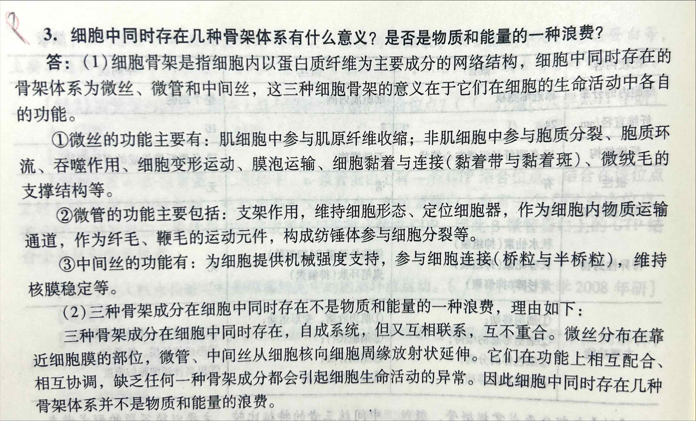

### Front
简述微丝的结构、特点及作用

### Back
**一、微丝的结构**
1. **基本成分**：又称肌动蛋白丝（F-actin），主要结构成分是高度保守的肌动蛋白（actin）。
2. **组装与形态**：由球状肌动蛋白单体（G-actin）头尾相接组装成纤维状肌动蛋白（F-actin）。电镜下呈直径约为 \(7\text{nm}\) 的纽链，外观类似由两股肌动蛋白呈右手螺旋盘绕而成，螺距为 \(36\text{nm}\)。

**二、微丝的特点**
1. **结构极性**：肌动蛋白单体上的裂缝朝向一致，使微丝具有极性，有裂缝的一端为负极（\(-\)），另一端为正极（\(+\)）。
2. **动态不稳定性与踏车行为**：组装依赖 ATP 及二价阳离子（如 \(\text{Mg}^{2+}\)），在正极快速聚合延长，在负极解聚缩短，表现出“踏车现象”。
3. **特异性药物反应**：细胞松弛素 B 能切断微丝并阻碍正极聚合，鬼笔环肽能抑制微丝解聚以稳定其结构。

**三、微丝的作用**
1. **维持细胞形态与结构支撑**：形成细胞皮层（膜骨架）以提供质膜强度，支撑微绒毛及黏着斑中的应力纤维。
2. **介导细胞运动与迁移**：推动板状伪足和丝状伪足的伸出，驱动细胞变形运动与定向迁移。
3. **参与肌肉收缩**：作为细肌丝的主要成分，与肌球蛋白组成的粗肌丝发生相对滑动引起肌肉收缩。
4. **完成胞质分裂**：有丝分裂末期在分裂沟组装形成收缩环（胞质分裂环），收缩将细胞一分为二。
5. **胞内运输与胞质环流**：作为肌球蛋白等分子马达的运动轨道，介导囊泡运输及胞质环流。

---
### Front
微丝的组装条件、过程及影响组装的药物

### Back
**一、微丝组装的条件**
1. **单体与能量状态**：肌动蛋白单体（G-actin）必须先结合 ATP 才能参与微丝的聚合组装。
2. **离子种类与浓度**：组装依赖于适当浓度的二价阳离子（如 \(\text{Mg}^{2+}\)）以及较高的单价阳离子（\(\text{Na}^+\)、\(\text{K}^+\)）；而在低离子浓度或极低 \(\text{Ca}^{2+}\) 条件下微丝趋于解聚。
3. **临界浓度（\(C_c\)）**：游离肌动蛋白单体的浓度必须高于微丝组装的临界浓度。

**二、微丝组装的过程**
1. **成核期（核化阶段）**：2–3 个 G-actin 形成寡聚体作为组装的核心（为微丝组装的限速步骤），也可由 Arp2/3 复合物等成核蛋白启动成核反应。
2. **延伸期（延长阶段）**：结合 ATP 的 G-actin 快速结合到寡聚体末端（主要在正极加码），使微丝迅速延伸。单体结合后，其 ATPase 活性被激活，将 ATP 水解为 ADP。
3. **稳定期（动态平衡）**：游离单体浓度下降至临界浓度，亚基的聚合速度与解聚速度达到平衡。由于正极临界浓度低于负极，单体在正极不断添加而在负极不断解离，表现出“踏车现象”。

**三、影响微丝组装的特异性药物**
1. **细胞松弛素 B（Cytochalasin B）**：切断微丝并结合在微丝正极，阻断肌动蛋白单体的进一步聚合（对解聚无明显影响），从而破坏微丝网络结构，抑制细胞运动。
2. **鬼笔环肽（Phalloidin）**：与微丝（F-actin）表面具有强亲和力（不结合游离单体），阻止微丝解聚，使其保持过度稳定状态，同样抑制细胞的动态运动。

---

<!-- anki-id: cell-biology-jsonl-000073 -->
### Front
马达蛋白的定义与种类

### Back
**一、马达蛋白的定义**
马达蛋白（分子马达）是指细胞内一类利用水解 ATP 提供的能量转化为机械能，沿细胞骨架纤维（微管或微丝）有规则地定向移动，从而运输所携带“货物”（如膜性细胞器、囊泡或大分子复合物）或介导细胞运动的蛋白质。

**二、马达蛋白的种类**
细胞内主要包含三大类马达蛋白超家族：

1. **肌球蛋白（Myosin）**
   - **结合轨道**：依赖于**微丝**（肌动蛋白丝）。
   - **运动方向**：绝大多数向微丝的正极（\(+\)）移动（除 VI 型肌球蛋白向负极移动外）。
   - **主要功能**：参与肌肉收缩、胞质分裂环收缩、伪足运动及胞质环流/膜泡运输等。

2. **驱动蛋白（Kinesin）**
   - **结合轨道**：依赖于**微管**。
   - **运动方向**：绝大多数（N-驱动蛋白）沿微管从**负极（\(-\)）向正极（\(+\)）**方向移动（离心运输）。
   - **主要功能**：介导膜性细胞器（如内质网）和囊泡向细胞外周的定向运输及参与信号转导。

3. **动力蛋白（Dynein）**
   - **结合轨道**：依赖于**微管**（已知分子量最大、移动速度最快的马达蛋白）。
   - **运动方向**：沿微管从**正极（\(+\)）向负极（\(-\)）**方向移动（向心运输）。
   - **主要分类与功能**：
     - **胞质动力蛋白**：负责向近核方向运输囊泡/细胞器（如高尔基体定位）以及协助有丝分裂中染色体的分离。
     - **轴丝动力蛋白**：存在于纤毛和鞭毛轴丝中，介导相邻双联微管之间的相对滑动，驱动纤毛和鞭毛弯曲摆动。

---
### Front
简述肌动蛋白与肌球蛋白的异同点

### Back
| 比较项目 | 肌动蛋白（Actin） | 肌球蛋白（Myosin） |
| :--- | :--- | :--- |
| **基本身份** | 构成微丝（细肌丝）的主要结构蛋白 | 依赖于微丝的分子马达（马达蛋白） |
| **结构组成** | 单体（G-actin）为球状蛋白，含裂缝；组装成双股螺旋状的纤维（F-actin） | 通常由重链和轻链组成的不对称复合蛋白，具有头部（马达结构域）、颈部和尾部 |
| **功能作用** | 提供结构支撑，构成微丝轨道，参与细胞形态维持、微绒毛支撑及伪足形成 | 利用 \(\text{ATP}\) 水解沿微丝移动，驱动肌肉收缩、胞质分裂环收缩及胞内物质运输 |
| **相同点** | 1. **能量依赖**：均具有 \(\text{ATP}\) 结合位点，通过 \(\text{ATP/ADP}\) 的构象转换行使功能。 2. **进化保守**：在生物进化过程中均具有高度保守的氨基酸序列。 3. **协同作用**：两者可特异性结合形成肌动球蛋白复合物，共同构成细胞运动与肌肉收缩的动力系统。 |

---

<!-- anki-id: cell-biology-jsonl-000074 -->
### Front
【题目 27】细胞内依赖于微管和微丝的分子马达有哪些？简述其功能。

### Back
**一、 依赖于微丝的分子马达：肌球蛋白超家族（Myosin）**
结合微丝并通过水解 ATP 产生能量沿微丝移动。主要分类与功能如下：
1. **Ⅱ型肌球蛋白（传统肌球蛋白）**：由2条重链和4条轻链组成，可装配成双极性粗肌丝。在肌细胞中参与肌肉收缩；在非肌细胞中构成收缩环（分裂环）介导胞质分裂，并参与应力纤维的活动。
2. **Ⅴ型肌球蛋白**：二聚体分子马达，具有两个头部，主要向微丝正极移动，负责细胞内囊泡、内膜泡及细胞器的运输，并引起植物细胞的胞质环流。
3. **Ⅰ型及其他非传统肌球蛋白（如Ⅵ、Ⅹ型）**：Ⅰ型为单头分子，尾部可与质膜结合，参与细胞皮层与特化结构（如微绒毛）的形成、内吞作用及吞噬泡的运输。

**二、 依赖于微管的分子马达**
结合微管并利用 ATP 水解产生的化学能转化为机械能运输货物，分为两大类：

| 分子马达类型 | 运动方向 / 分布 | 主要功能 |
| :--- | :--- | :--- |
| **驱动蛋白 (Kinesin)** | 主要向微管**正极**（+端，胞质外周）移动 | 负责将膜性细胞器、囊泡（如神经元轴突中的突触小泡）及大分子复合物运往胞质外周；部分成员参与调节微管动态不稳定性和有丝分裂纺锤体结构。 |
| **胞质动力蛋白 (Cytoplasmic Dynein)** | 向微管**负极**（-端，近核/中心体）移动 | 负责高尔基体的近核定位，介导内质网、溶酶体及膜泡的向核运输，并参与有丝分裂后期染色体的分离与纺锤体装配。 |
| **轴丝动力蛋白 (Axonemal Dynein)** | 存在于纤毛和鞭毛的轴丝（9+2结构）中 | 通过 ATP 水解驱动相邻外周二联体微管之间发生相互滑动，将滑动转化为局部的弯曲运动，引起纤毛和鞭毛的摆动。 |

---

### Front
简述肌球蛋白的结构、种类及作用

### Back
**一、肌球蛋白的结构**
肌球蛋白通常由重链和轻链组成，分子结构包含三个主要功能域：
1. **马达结构域（头部）**：高度保守，包含微丝结合位点和具有 \(\text{ATP}\) 酶活性的 \(\text{ATP}\) 结合位点，负责将化学能转化为机械能。
2. **调节结构域（颈部）**：连接头部和尾部的 \(\alpha\)-螺旋区，为肌球蛋白轻链结合部位，在运动中发挥“杠杆”作用。
3. **尾部结构域**：结构多样，决定肌球蛋白是自我组装形成双极纤维，还是与特定的“货物”（如膜泡、细胞器）结合。

**二、肌球蛋白的种类**
1. **II 型肌球蛋白（传统肌球蛋白）**：由 2 条重链和 4 条轻链组成，具有双头结构，尾部可尾尾相接组装成双极粗肌丝，主要参与肌肉收缩及胞质分裂。
2. **I 型肌球蛋白**：单头结构（仅 1 条重链），无长尾，尾部可与质膜结合，参与微绒毛支撑、内吞作用及质膜突起形成。
3. **V 型肌球蛋白**：双头二聚体，颈部较长且步距较大，作为分子马达负责细胞内膜泡和细胞器的定向运输（如介导胞质环流）。
4. **其他非传统肌球蛋白**：如 VI 型（绝大多数肌球蛋白向微丝正极移动，而 VI 型向负极移动）、IX 型和 X 型等。

**三、肌球蛋白的作用**
1. **驱动肌肉收缩**：作为粗肌丝的主要成分，与细肌丝（肌动蛋白）发生相对滑动产生收缩力。
2. **介导胞质分裂与非肌细胞收缩**：有丝分裂末期在分裂沟形成收缩环（胞质分裂环）完成胞质分离；在非肌细胞中参与应力纤维的拉力产生。
3. **胞内物质运输与胞质环流**：沿微丝轨道定向运输囊泡、膜性细胞器及大分子复合物，驱动胞质环流。
4. **维持细胞形态与膜骨架支撑**：与质膜及微丝网络结合，支撑微绒毛等特化结构并参与伪足形成及细胞迁移。

---

### Front
简述微管的组成、性质及特点

### Back
**一、微管的组成**
1. **基本结构单位**：由 \(\alpha\)-微管蛋白和 \(\beta\)-微管蛋白结合成的 \(\alpha/\beta\)-异二聚体。
2. **形态结构**：由 13 根纵向排列的原纤维（原纤丝）合拢围成中空管状结构，外径约为 \(24\text{nm}\)，内径约为 \(15\text{nm}\)。

**二、微管的性质**
1. **表面电荷**：微管蛋白亚基 C 端富含酸性氨基酸序列，使微管表面带有较强的负电荷。
2. **功能性结合位点**：
   - **N 位点（不可交换位点）**：位于 \(\alpha\)-微管蛋白上，结合的 GTP 不发生水解。
   - **E 位点（可交换位点）**：位于 \(\beta\)-微管蛋白上，结合的 GTP 在二聚体组装入微管后被水解为 GDP。
   - **药物与离子结合位点**：具有二价阳离子结合位点，以及秋水仙素、紫杉醇、长春花碱等特异性药物结合位点。

**三、微管的特点**
1. **结构与功能极性**：由 \(\alpha/\beta\)-异二聚体的定向排列决定，\(\beta\)-微管蛋白暴露的一端为正极（\(+\)，组装延伸较快），\(\alpha\)-微管蛋白暴露的一端为负极（\(-\)，组装较慢）。
2. **动态不稳定性与踏车现象**：受末端“GTP 帽”状态调控，微管可在聚合（生长）与解聚（缩短）之间快速转换，并在临界浓度下表现出正极亚基添加、负极亚基解离的踏车行为。
3. **MTOC 定向锚定**：细胞内微管负极通常锚定于微管组织中心（MTOC，如中心体或基体），正极向细胞外周放射状延伸。

---

### Front
微管的类型

### Back
**一、按结构形态（横切面管壁组成）分类**
1. **单管（Singlet microtubule）**：由 13 根原纤维围成的完整管状结构，如细胞质微管和纺锤体微管。
2. **二联管（Doublet microtubule）**：由完全微管（A管）与不完全微管（B管）融合而成，存在于纤毛和鞭毛的轴丝中。
3. **三联管（Triplet microtubule）**：由 A、B、C 三根亚纤维融合组成，存在于中心体（中心粒）和基体中。

---

<!-- anki-id: cell-biology-jsonl-000075 -->
### Front
【题目 34】简述微丝和微管的组装过程。

### Back
**一、 微丝的组装过程**
1. **成核反应（Nucleation）**：形成由 2~3 个肌动蛋白单体（G-actin）组成的寡聚体，是 G-actin 组装的限速步骤。细胞内常由 Arp2/3 复合物等成核蛋白结合肌动蛋白单体，提供组装的起始点。
2. **纤维的延长（Elongation）**：结合 ATP 的肌动蛋白单体（ATP-G-actin）快速加到寡聚体末端（主要是正极），使纤维不断延伸。肌动蛋白具有 ATP 酶活性，组装后 ATP 水解为 ADP。
3. **稳定期（Equilibrium phase）**：当微丝组装到一定长度，肌动蛋白亚基的组装与去组装速度达到动态平衡，微丝长度保持相对恒定。

**二、 微管的组装过程**
1. **成核反应（Nucleation）**：结合 GTP 的 \(\alpha/\beta\)-微管蛋白异二聚体首先纵向聚合形成短的原纤维，随后通过侧面增加二聚体扩展为片层；当片层加宽至大致 13 根原纤维时，即合拢成为一段中空的微管。细胞内通常起始于微管组织中心（MTOC，如中心体上的 \(\gamma\)-微管蛋白环状复合物）。
2. **微管的延长（Elongation）**：新的 \(\alpha/\beta\)-微管蛋白异二聚体不断加到微管末端（正极延伸快，负极延伸慢），使微管不断延伸。

---

### Front
微管的动态不稳定性及其生理意义

### Back
**1. 概念（动态不稳定性）：**
微管是一种高度动态的结构体系，通过微管蛋白亚基的持续组装与去组装，实现微管长度的延长或缩短。在同一时刻，细胞内一部分微管正在组装延伸，而另一部分处于解聚缩短状态。

**2. 生理意义：**
* **骨架更新与稳态维持：** 边组装边解体使微管网络得以不断更新，以便细胞在不同生理状态下调整骨架组织形式。
* **参与细胞分裂：** 在有丝分裂期，胞质微管迅速解体并重新组装为纺锤体微管，通过微管的动态组装与去组装牵拉染色体分离及推移纺锤体两极。
* **驱动细胞迁移与极化：** 微管正极端的动态不稳定性和定向捕获稳定，促进了细胞的极化以及与迁移相关物质的定向运输。
* **介导物质运输与细胞器定位：** 动态重排微管网络，为马达蛋白沿微管运输货物及细胞内区室化细胞器的定点分布提供轨道与机械支撑。

---

### Front
论述：作用于微管的特异性药物及其作用机制与效应

### Back

1. **抑制组装类（秋水仙素、诺考达唑）**：通过结合游离亚基阻止微管延伸，而解聚持续进行，导致微管网络解体。
2. **抑制解聚类（紫杉醇）**：通过结合微管纤维阻止其去组装，使微管过度稳定，无法正常动态解聚。
两类药物均通过破坏微管的动态不稳定性，阻断有丝分裂纺锤体的功能，进而终止细胞周期运行。

---

<!-- anki-id: cell-biology-jsonl-000076 -->
### Front
高等动物的个体运动有赖于骨骼肌的收缩，每根肌原纤维称为肌节，根据肌节的结构，论述肌丝滑动模型的调控。/简述由神经冲动诱发的肌肉收缩基本过程。

### Back
1. **动作电位产生与传导**：神经冲动传至运动终板，引发肌细胞质膜去极化，动作电位沿 T 小管传导至肌质网。
2. **\(\text{Ca}^{2+}\) 的释放**：肌质网去极化促使 \(\text{Ca}^{2+}\) 释放至肌浆，胞浆 \(\text{Ca}^{2+}\) 浓度迅速升高。
3. **结合位点暴露**：\(\text{Ca}^{2+}\) 与肌钙蛋白（Tn-C）结合引发构象变化，带动原肌球蛋白发生位移，暴露出细肌丝上肌动蛋白与肌球蛋白头部的结合位点。
4. **粗细肌丝相对滑动（横桥循环）**：
   - 肌球蛋白头部结合并水解 ATP 获能，发生旋转翘起；
   - 在 \(\text{Ca}^{2+}\) 存在下，肌球蛋白头部与细肌丝结合形成交联桥；
   - 释放 \(\text{P}_{\text{i}}\) 引发头部与颈部构象摆动，牵拉细肌丝向粗肌丝中央滑动；
   - 释放 ADP 并结合新的 ATP，肌球蛋白头部与细肌丝脱离，循环进行。
5. **收缩终止与恢复**：神经冲动停止后，肌质网通过钙泵回收 \(\text{Ca}^{2+}\)，胞浆 \(\text{Ca}^{2+}\) 浓度降低，结合位点重新被掩盖，肌肉恢复舒张。

---

### Front
论述：微管组织中心（MTOC）的定义、类型及生物学作用

### Back
**一、微管组织中心（MTOC）的定义**
在活细胞内，能够起始微管的成核作用，并使之延伸的细胞结构称为微管组织中心（MTOC）。

**二、主要类型**
1. **中心体**：动物细胞内主要的 MTOC。
2. **基体**：位于纤毛和鞭毛基部的微管组织中心。
3. **其他结构**：如上皮细胞紧密顶端面、高尔基体的反面网状结构等。

**三、主要生物学作用**
1. **起始微管成核与组装**：提供微管成核和延伸的位点。微管在中心体上的组装起始于中心体周围物质（PCM）上的 \(\gamma\)-微管蛋白环状复合物（\(\gamma\)-TuRC），该复合物决定了微管横切面上原纤丝的数目（13根）以及微管的极性（负极结合在 MTOC 上，正极向外延伸）。
2. **调节微管活动与空间组织**：MTOC 是微管活动的“指挥部”，能根据细胞的需要调节微管的活动。例如在有丝分裂间期组装胞质微管网络；在有丝分裂期胞质微管解聚，组装形成纺锤体微管。

---

<!-- anki-id: cell-biology-jsonl-000077-01 -->
### Front
中间丝特点

### Back
1. **结构与极性**：核心直径约 10 nm，由杆状蛋白经过二聚体、反向平行四聚体等交叠组装而成；分子两端对称，**无极性**。
2. **装配与能量依赖**：可自我组装，**不消耗能量**（不需要 ATP、GTP 或结合蛋白的辅助），且装配与温度及蛋白浓度无关；胞内无游离单体的动态蛋白库。
3. **动态行为特征**：**不表现典型的踏车行为**，新的中间丝蛋白可通过交换方式掺入到原有纤维中；其装配与解聚在细胞周期中受**磷酸化与去磷酸化**调控。
4. **稳定性与马达/药物**：结构比微丝和微管更稳定，能抗高盐和非离子去垢剂抽提；**无特异性马达蛋白**，也**无特异性药物**。
5. **组织特异性**：不同分化类型的细胞表达不同的中间丝蛋白（如Ⅰ/Ⅱ型角蛋白、Ⅲ型波形蛋白/结蛋白/GFAP、Ⅳ型神经丝蛋白、Ⅴ型核纤层蛋白等），具有组织特异性，并非所有真核细胞必需。
6. **细胞内分布与联系**：胞质中贯穿核周至质膜，参与形成桥粒和半桥粒以维持细胞机械强度与组织整体性；核内由核纤层蛋白形成核纤层，支撑核膜并锚定染色质。

### OriginalMaterial

---

<!-- anki-id: cell-biology-jsonl-000119 -->
### Front
[题目 28] 试比较肌动蛋白与肌球蛋白的异同点

### Back
一、不同点
(1) <u>结构不相同</u>
肌动蛋白由单个肽链折叠而成，并呈球状，在肌动蛋白分子间有一个裂缝将肌动蛋白分成两瓣，裂缝内有 ATP 结合位点。肌球蛋白，具有两个头部和一个尾部，由两条具有马达结构域的重链和四条起调节作用的轻链构成；
(2) <u>存在位置不同</u>
肌球蛋白：存在于平滑肌中。肌动蛋白：存在于横纹肌肌肌原纤维的细丝中，也存在于平滑肌中。
(3) <u>功能不同</u>
肌动蛋白主要作为构成微丝及细胞骨架成分；肌球蛋白主要作为细胞运动收缩，以及物质运输的主要承担者。

二、相同点
(1) 都具有 ATP 的结合位点，并且通过 ATP/ADP 的转换而行使其功能。
(2) 都具有一段保守的氨基酸序列。

### OriginalMaterial

---

### Front
驱动蛋白（Kinesin）沿微管运动的机制及两种分子模型

### Back
**1. 运动机制：**
* **能量与位点：** 驱动蛋白的马达结构域具有 **ATP结合位点** 与 **微管结合位点**，依靠水解ATP提供能量沿微管移动。
* **构象变化与步进：** 前方的马达结构域结合ATP引发构象变化并与微管紧密结合，推动后方的马达结构域向前越过前方，结合到微管正极一侧的新位点；随后前面的头部释放ADP，后面的头部水解ATP，使两个头部互换位置并向微管正极迈进一步。
* **持续性运动：** 马达结构域在ATP循环的大部分时间里均与微管紧密结合，保证驱动蛋白及所运载的货物在移动过程中不会脱离微管。

**2. 两种分子模型：**
* **“步行”模型（Hand-over-hand model）：** 驱动蛋白的两个球状头部**交替向前**。每水解1分子ATP，落后的马达结构域向前移动两倍步距（**16 nm**），原来的领先头部则在下一个循环中向前移动（多数学者接受此模型）。
* **“尺蠖”爬行模型（Inchworm model）：** 驱动蛋白两个头部中的**一个始终向前，另一个永远在后**，每步移动 **8 nm**。

---

<!-- anki-id: cell-biology-jsonl-000136 -->
### Front
试述纤毛和鞭毛的结构与功能。

### Back
**一、 纤毛和鞭毛的结构**
纤毛与鞭毛是真核细胞表面由质膜包围的细长突起，主要由**轴丝**和**基体**两部分构成：
1. **轴丝（Axoneme）结构（“9+2”模式）**：
   - **外周二联体微管**：外围包含 9 组二联体微管。每组由 A 亚纤维（由 13 个亚基组成的完全微管）和 B 亚纤维（由 10 个亚基组成的不完全微管）共享管壁组成。A 管上附着有伸向相邻 B 管的**轴丝动力蛋白臂**（外臂与内臂）。
   - **中央微管**：中央为 2 根由中央鞘包围的完全单体微管。
   - **连接与辅件结构**：相邻外周二联体之间由弹性连接蛋白（Nexin）连接；A 管与中央鞘之间由放射辐条相连，将整个轴丝连成一体。
2. **基体（Basal body）结构（“9+0”模式）**：
   - 位于纤毛和鞭毛基部的细胞质膜内侧，结构与中心粒类似。
   - 外围由 9 组三联体微管（A、B、C 管）环状排列组成，缺乏中央微管（“9+0”排列）。

**二、 纤毛和鞭毛的运动机制**
运动由**轴丝动力蛋白**介导：动力蛋白结合并水解 ATP，沿相邻二联体微管的 B 管移动，引发二联体之间的相对滑动；在放射辐条和连接蛋白等结构的弹性阻碍下，这种局部的相对滑动被转化为轴丝的横向弯曲摆动。

**三、 纤毛和鞭毛的主要功能**
1. **运动装置**：
   - 驱动单细胞原生生物或精子在液体介质中游动。
   - 推动高等动物组织表面的液体定向流动（如呼吸道上皮纤毛清除异物、输卵管纤毛推动卵细胞移动）。
2. **传输与感受装置**：
   - 依赖鞭毛/纤毛内转运机制（IFT）传输物理或化学信号分子。
   - 接收并传递外界信号，参与细胞信号传导，调控靶细胞的定向分化、细胞极性以及器官发育（如初生纤毛/原生纤毛常作为感应器）。

### OriginalMaterial

---
<!-- anki-id: cell-biology-jsonl-000069 -->
### Front
四、微管、微丝、中间丝的比较（见表 8-1）

### Back
表 8-1 微管、微丝、中间丝的比较

| 比较内容 | 微管 | 微丝 | 中间丝 |
| :--- | :--- | :--- | :--- |
| **蛋白质组成** | 微管蛋白二聚体 | 球形肌动蛋白 | 不同来源的组织细胞表达不同类型的中间丝蛋白 |
| **细胞内的分布** | 靠近细胞核 | 细胞质内侧 | 整个细胞 |
| **纤维直径/nm** | 24 | 7 | 10 |
| **纤维结构** | 13条原纤丝组成空心管状 | 双链螺旋 | 32条原纤丝组成的多级螺旋 |
| **极性** | 有 | 有 | 无 |
| **单体蛋白库** | 有 | 有 | 无 |
| **特异性药物** | 秋水仙素（抑组装） 长春花碱（抑组装） 紫杉醇（抑解聚） | 细胞松弛素B（抑组装） 鬼笔环肽（抑解聚） | 无 |
| **主要功能** | ①细胞移动； ②细胞形态的维持； ③染色体的分离； 细胞器的移动 | ①肌肉收缩、变形运动； ②细胞爬行； ③胞质分裂； ④保持细胞形态 | ①支持结构、维持细胞形态； ②形成核纤层、核骨架； ③提高神经细胞的强度 |

### OriginalMaterial

---

<!-- anki-id: cell-biology-jsonl-000072 -->
### Front
[题目12] 细胞骨架结构成分的主要装配特点。

### Back
**一、 通用装配特点**
细胞骨架由简单的蛋白质亚基自组装而成，具有高度的动态不稳定性，其组装与解聚过程在时间和空间上受细胞信号高度调控。

**二、 三种骨架成分的装配特点对比**

| 骨架成分 | 组装亚基与结构极性 | 装配过程与方式 | 能量与离子依赖 | 动态行为特征 |
| :--- | :--- | :--- | :--- | :--- |
| **微丝 (MF)** | G-肌动蛋白单体头尾相接成双股螺旋（F-肌动蛋白）；**具有极性**（正极与负极） | 经历成核期（形成寡聚体，为限速步骤）、延长期和稳定期 | 需结合 **ATP** 及 Mg²⁺ 等离子进行组装，组装后 ATP 水解为 ADP | 体外具有 **踏车现象**（正极装配延长，负极去装配缩短） |
| **微管 (MT)** | α/β-微管蛋白异二聚体首尾相连形成原纤维，13根原纤维合拢成中空管；**具有极性** | 体外分为成核（短丝扩展为片层合拢）与延伸阶段；细胞内组装受 **MTOC** 调控 | 亚基需结合 **GTP** 参与组装 | 具有动态不稳定性及体外 **踏车行为** |
| **中间丝 (IF)** | 杆状蛋白（单体→二聚体→反向平行四聚体→原纤维→10nm圆柱纤维）；**无极性** | 可从头自我组装，新的蛋白可通过交换方式掺入原有纤维中 | 自我组装，**不消耗能量**（无需 ATP/GTP） | 无极性，不表现典型踏车行为；结构比微丝微管更稳定 |

---

<!-- anki-id: cell-biology-jsonl-000071 -->
### Front
3. 细胞中同时存在几种骨架体系有什么意义？是否是物质和能量的一种浪费？

### Back
(1)细胞骨架是指细胞内以蛋白质纤维为主要成分的网络结构，细胞中同时存在的骨架体系为微丝、微管和中间丝，这三种细胞骨架的意义在于它们在细胞的生命活动中各自的功能。

①微丝的功能主要有：肌细胞中参与肌原纤维收缩；非肌细胞中参与胞质分裂、胞质环流、吞噬作用、细胞变形运动、膜泡运输、细胞黏着与连接（黏着带与黏着斑）、微绒毛的支撑结构等。
②微管的功能主要包括：支架作用，维持细胞形态、定位细胞器，作为细胞内物质运输通道，作为纤毛、鞭毛的运动元件，构成纺锤体参与细胞分裂等。
③中间丝的功能有：为细胞提供机械强度支持，参与细胞连接（桥粒与半桥粒），维持核膜稳定等。

(2)三种骨架成分在细胞中同时存在不是物质和能量的一种浪费，理由如下：

三种骨架成分在细胞中同时存在，自成系统，但又互相联系，互不重合。微丝分布在靠近细胞膜的部位，微管、中间丝从细胞核向细胞周缘放射状延伸。
它们在功能上相互配合、相互协调，缺乏任何一种骨架成分都会引起细胞生命活动的异常。
因此细胞中同时存在几种骨架体系并不是物质和能量的浪费。

### OriginalMaterial

---
